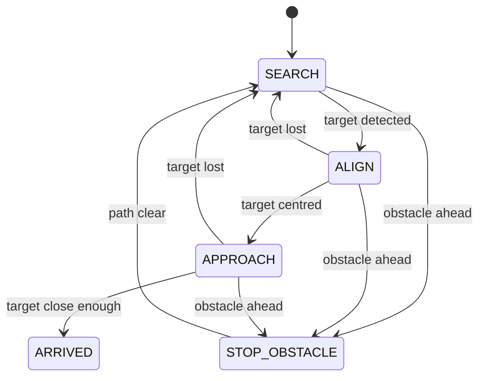

# Navigation_xrc

<<<<<<< HEAD
Autonomous navigation prototype for a four-wheel differential-drive rover, built in **ROS 2** and **Gazebo** for the EPFL Xplore Rover Challenge.

The rover searches for a visual target with its camera, aligns on it, drives up to it and stops, while a 2D LiDAR guards the front of the robot against obstacles. Everything runs in simulation, so the behaviour can be tuned and tested before it goes on the real hardware.

## What is in this repository

| Path | Role |
| --- | --- |
| `autonomous_nav.py` | ROS 2 node: camera target detection, LiDAR obstacle guard and the navigation state machine |
| `camera_web.py` | Browser dashboard (Flask): live camera stream, live LiDAR scan, 2D point map and manual drive |
| `worlds/my_world.sdf` | Gazebo world: walled maze, QR target panel and the rover model with its sensors |
| `urdf/` | Robot description (SDF and Xacro) |
| `launch/simulation.launch.py` | Starts Gazebo, the ROS–Gazebo bridge and RViz 2 |

## How the navigation works

The node runs a closed control loop at 10 Hz and publishes velocity commands (`geometry_msgs/Twist`).



- **SEARCH**: the rover rotates in place until the camera sees the target.
- **ALIGN**: a proportional controller turns the rover until the target is centred in the image (within 30 px).
- **APPROACH**: the rover drives forward while still correcting its heading. Its speed drops as the target grows in the image, which serves as a distance estimate.
- **ARRIVED**: the rover stops once the target fills enough of the image.
- **STOP_OBSTACLE**: the LiDAR check has priority over every other state. If anything is closer than 0.2 m in the ±20° front sector, the rover stops, and it resumes once the path is clear again.

The target is a QR panel detected with OpenCV (`cv2.QRCodeDetector`). Gains, speeds and thresholds are constants at the top of `autonomous_nav.py`.

## Simulated rover

| Element | Specification |
| --- | --- |
| Drive | Four wheels, differential drive, 0.3 m track, 0.05 m wheel radius |
| LiDAR | 2D, 360 samples, 0.12–10 m range, 10 Hz |
| Camera | 640 × 480, 80° horizontal field of view, 30 Hz |
| Limits | 0.5 m/s linear, 1 rad/s angular |

### ROS 2 topics

| Topic | Type | Direction |
| --- | --- | --- |
| `/camera/image` | `sensor_msgs/Image` | Gazebo → ROS |
| `/scan` | `sensor_msgs/LaserScan` | Gazebo → ROS |
| `/model/my_robot/odometry` | `nav_msgs/Odometry` | Gazebo → ROS |
| `/model/my_robot/cmd_vel` | `geometry_msgs/Twist` | ROS → Gazebo |

## Running it

Developed on Ubuntu 24.04 with ROS 2 and Gazebo Harmonic.

**Dependencies:** `ros_gz_sim`, `ros_gz_bridge`, `robot_state_publisher`, `rviz2`, `cv_bridge`, plus the Python packages `opencv-python`, `numpy` and `flask`.

```bash
# 1. Build the package (named my_robot) inside a ROS 2 workspace
cd ~/ros2_ws/src
git clone https://github.com/Iyad-coder/Navigation_xrc.git
cd ~/ros2_ws
colcon build --packages-select my_robot
source install/setup.bash

# 2. Start the simulation (Gazebo + bridge + RViz 2)
ros2 launch my_robot simulation.launch.py

# 3. In a second terminal, start the autonomous navigation
python3 src/Navigation_xrc/autonomous_nav.py

# Optional: start the dashboard, then open http://localhost:5000
python3 src/Navigation_xrc/camera_web.py
```

The dashboard shows the camera feed and the LiDAR scan live, accumulates scan points into a 2D map using the rover's odometry, and lets you drive the rover by hand.

## Scope

This repository holds the simulation side of the project. The physical rover (ESP32, custom PCB, IMU, LiDAR and ultrasonic sensors) and the software that runs on it were developed with the EPFL Xplore rover team.

## Author

Iyad Abid, B.Sc. Microengineering, EPFL · [iyad-coder.github.io](https://iyad-coder.github.io/)
=======
Gazebo simulation and autonomous navigation for a small differential-drive rover
(ROS 2 Jazzy, Gazebo Harmonic).

## What is in here

| File | Role |
|---|---|
| `worlds/my_world.sdf` | Test maze with the rover, a 360° LiDAR and a camera |
| `worlds/target_world.sdf` | Same maze with an orange target panel and an IMU on the chassis |
| `autonomous_nav.py` | First navigation node: QR-code target, stop in front of obstacles |
| `autonomous_nav_hsv.py` | Navigation node: HSV target detection, state machine, LiDAR gap finding |
| `covariance_relay.py` | Adds covariances to the simulator's odometry and IMU so the EKF accepts them |
| `config/ekf.yaml` | `robot_localization` EKF: wheel odometry + IMU |
| `camera_web.py` | Web control panel (camera, LiDAR view, teleoperation) |

## How the navigation works

```
SEARCH -> ALIGN -> APPROACH -> AVOID -> ARRIVED
```

- **SEARCH**: turn on the spot until the camera sees the panel (HSV threshold).
- **ALIGN**: centre the panel in the image.
- **APPROACH**: drive towards it. The panel's width in pixels gives its distance,
  so its position is remembered even when a wall hides it.
- **AVOID**: if the way is blocked, take the free LiDAR direction closest to the target,
  and resume once the line to the target is clear.
- **ARRIVED**: stop 0.75 m from the panel.

The pose comes from `/odometry/filtered`, the output of the EKF.

## Run it

```bash
gz sim -s -r worlds/target_world.sdf

ros2 run ros_gz_bridge parameter_bridge \
  '/scan@sensor_msgs/msg/LaserScan[gz.msgs.LaserScan' \
  '/clock@rosgraph_msgs/msg/Clock[gz.msgs.Clock' \
  '/imu@sensor_msgs/msg/Imu[gz.msgs.IMU' \
  '/camera/image@sensor_msgs/msg/Image[gz.msgs.Image' \
  '/model/my_robot/cmd_vel@geometry_msgs/msg/Twist]gz.msgs.Twist' \
  '/model/my_robot/odometry@nav_msgs/msg/Odometry[gz.msgs.Odometry'

python3 covariance_relay.py
ros2 run robot_localization ekf_node --ros-args --params-file config/ekf.yaml
python3 autonomous_nav_hsv.py
```

In RViz, set the fixed frame to `my_robot/odom` and add `/scan`, `/camera/annotated`
and `/nav/markers`.

## Status

`autonomous_nav_hsv.py`, `covariance_relay.py` and `config/ekf.yaml` are a re-implementation
of the rover's navigation for the simulation. Tested on one run in `target_world.sdf`:
the rover reaches the panel from its start position in about 50 s of simulated time.
>>>>>>> origin/main
