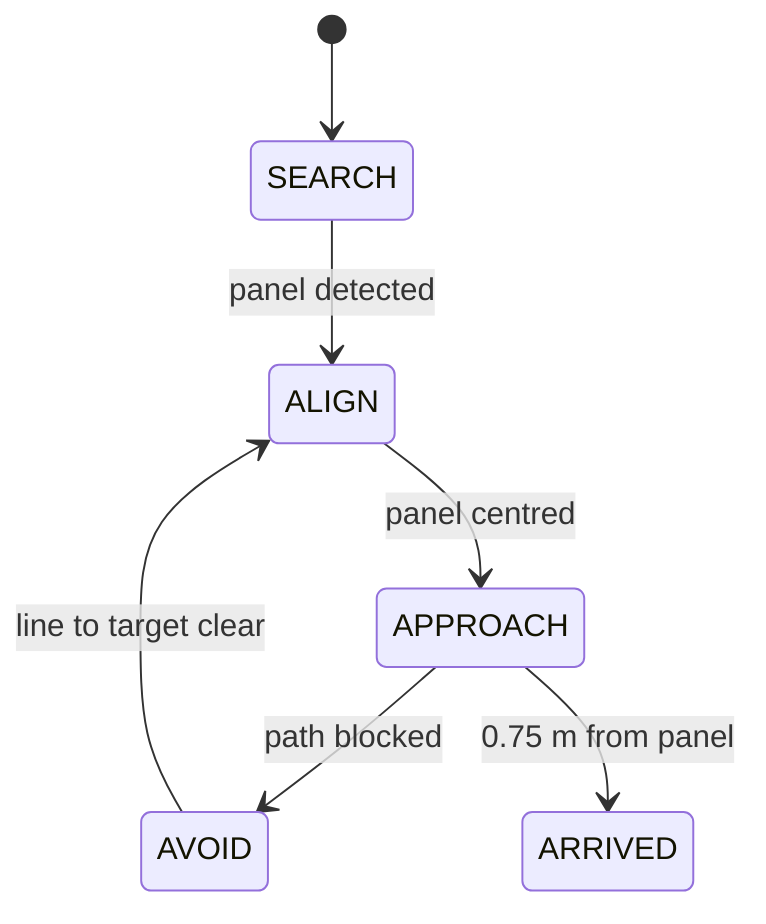

# Navigation_xrc

Autonomous navigation for a four-wheel differential-drive rover, built with **ROS 2 Jazzy** and **Gazebo Harmonic** for the EPFL Xplore Rover Challenge.

The rover finds a coloured target panel with its camera, drives to it through a maze and stops in front of it. A 2D LiDAR finds a free passage when the way is blocked, and an Extended Kalman Filter fuses wheel odometry and IMU data to estimate the rover's pose.

## How the navigation works

`autonomous_nav_hsv.py` runs a closed control loop at 10 Hz and publishes velocity commands.



- **SEARCH**: the rover turns on the spot until the camera sees the panel (HSV colour threshold).
- **ALIGN**: it centres the panel in the image.
- **APPROACH**: it drives towards the panel. The panel's width in pixels gives its distance, so the rover remembers the target's position even when a wall hides it.
- **AVOID**: if the way is blocked, it takes the free LiDAR direction closest to the target (gap finding), and resumes once the line to the target is clear.
- **ARRIVED**: it stops 0.75 m from the panel.

### Perception

The camera image is thresholded in HSV, and the largest contour is taken as the panel. With a pinhole camera model, the panel's apparent width gives its distance and its horizontal offset gives its bearing. Combined with the rover's pose, this places the target in the odometry frame.

### Obstacle avoidance

Each LiDAR scan is converted to points in the robot frame. A direction counts as free if no point lies inside a corridor as wide as the rover along that direction. The planner tests candidate headings from −130° to +130° in 5° steps and picks the free one closest to the target, with a little hysteresis so the rover does not oscillate between two gaps.

### State estimation

The pose comes from `/odometry/filtered`, the output of a `robot_localization` EKF (`config/ekf.yaml`) that fuses:

- wheel odometry: forward speed and yaw rate;
- IMU: yaw and yaw rate.

Gazebo publishes both with all-zero covariance matrices, and the filter does not fuse a measurement it is told is perfect. `covariance_relay.py` republishes them with realistic covariances, which is the same fix as on the real rover.

## What is in this repository

| File | Role |
| --- | --- |
| `autonomous_nav_hsv.py` | Navigation node: HSV target detection, state machine, LiDAR gap finding |
| `covariance_relay.py` | Adds covariances to the simulator's odometry and IMU so the EKF accepts them |
| `config/ekf.yaml` | `robot_localization` EKF: wheel odometry + IMU |
| `worlds/target_world.sdf` | Maze with an orange target panel; rover with a 360° LiDAR, a camera and an IMU |
| `autonomous_nav.py` | First navigation node: QR-code target, stop in front of obstacles |
| `worlds/my_world.sdf` | Maze used by the first node (QR panel, no IMU) |
| `camera_web.py` | Web control panel: camera stream, LiDAR view, 2D point map, teleoperation |
| `launch/simulation.launch.py` | Starts `my_world.sdf` with the ROS–Gazebo bridge and RViz 2 |

### Simulated rover

| Element | Specification |
| --- | --- |
| Drive | Four wheels, differential drive, 0.3 m track, 0.05 m wheel radius |
| LiDAR | 2D, 360 samples per scan |
| Camera | 640 × 480, 80° horizontal field of view |
| IMU | 50 Hz |

## Run it

Dependencies: `ros_gz_sim`, `ros_gz_bridge`, `robot_localization`, `cv_bridge`, `rviz2`, plus the Python packages `opencv-python`, `numpy` and `flask`.

Run each command in its own terminal, from the repository root:

```bash
# 1. Simulation
gz sim -s -r worlds/target_world.sdf

# 2. ROS–Gazebo bridge
ros2 run ros_gz_bridge parameter_bridge \
  '/scan@sensor_msgs/msg/LaserScan[gz.msgs.LaserScan' \
  '/clock@rosgraph_msgs/msg/Clock[gz.msgs.Clock' \
  '/imu@sensor_msgs/msg/Imu[gz.msgs.IMU' \
  '/camera/image@sensor_msgs/msg/Image[gz.msgs.Image' \
  '/model/my_robot/cmd_vel@geometry_msgs/msg/Twist]gz.msgs.Twist' \
  '/model/my_robot/odometry@nav_msgs/msg/Odometry[gz.msgs.Odometry'

# 3. Covariances, then the EKF
python3 covariance_relay.py
ros2 run robot_localization ekf_node --ros-args --params-file config/ekf.yaml

# 4. Navigation
python3 autonomous_nav_hsv.py
```

In RViz, set the fixed frame to `my_robot/odom` and add `/scan`, `/camera/annotated` and `/nav/markers`. The node also publishes its current state on `/nav/state`.

## Status

`autonomous_nav_hsv.py`, `covariance_relay.py` and `config/ekf.yaml` are a re-implementation of the rover's navigation for the simulation. Tested on one run in `target_world.sdf`: the rover reaches the panel from its start position in about 50 s of simulated time.

The physical rover (ESP32, custom PCB, IMU, LiDAR and ultrasonic sensors) was built with the EPFL Xplore rover team.

## Author

Iyad Abid, B.Sc. Microengineering, EPFL · [iyad-coder.github.io](https://iyad-coder.github.io/)
